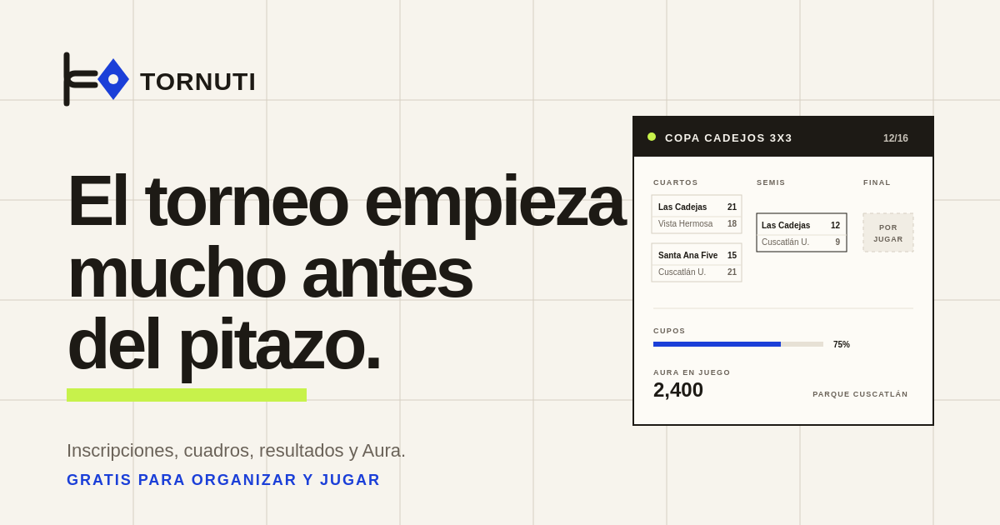

# Tornuti

Tornuti es una plataforma universal de torneos con un sistema de progreso llamado **Aura**. Sirve para básquet 3x3, Valorant, ajedrez, dominó, voleibol playa, carreras de relevos o cualquier competencia que una comunidad quiera organizar.

La idea es sencilla: una ficha clara, una lista de inscritos, un cuadro que se genera solo y un acta de resultados que no se pierde. Sin planes de pago, sin comisiones y sin obligar a nadie a usar una disciplina específica.

El proyecto está construido con Next.js y NestJS, usa PostgreSQL y se puede desplegar completo con servicios gratuitos.

## Qué incluye

### Producto

- Portada con agenda de torneos, categorías y un cuadro de demostración en vivo.
- Explorador con búsqueda, filtros por categoría, formato y estado, y orden por fecha, Aura o cupos.
- Ficha de torneo con resumen, reglas, organizador, participantes, cuadro, calendario y resultados.
- Inscripción local inmediata, con plazas visibles y cierre automático cuando se llena el cupo.
- Creación de torneos con vista previa en vivo, portada generada y validaciones de fechas y cupos.
- Ranking Aura, equipos, panel personal y actividad reciente.
- Modo claro y oscuro, navegación móvil, estados vacíos, errores y páginas legales.
- Contenido de demostración etiquetado como tal. No se presentan testimonios ni cifras inventadas como reales.

### API

- Registro e inicio de sesión con JWT y contraseñas con bcrypt.
- Perfiles, estadísticas de jugador y equipos con membresías.
- Torneos con formatos, reglas, cupos, inscripciones y permisos de organización.
- Cuadro de eliminación directa con siembra estándar y reparto de byes.
- Reporte de resultados, avance automático del ganador, estadísticas y Aura.
- Leaderboard público, historial de Aura y logros.
- Validación de entrada, filtro global de errores, CORS, Helmet, rate limiting y Swagger.
- Health check y readiness check para despliegues.

### Ingeniería

- Monorepo con workspaces de npm.
- TypeScript estricto en frontend y backend.
- 25 pruebas automatizadas: 16 de API y 9 de frontend.
- CI con GitHub Actions para typecheck, lint, pruebas y build.
- Migración SQL inicial versionada. No hace falta `db push` en producción.
- Seed reproducible con cuentas, equipos, torneos, partidos, Aura y logros de demostración.

## Stack

| Capa | Tecnología |
| --- | --- |
| Frontend | Next.js 15.5, React 18, TypeScript, Tailwind CSS |
| Backend | NestJS 11, Prisma 6, PostgreSQL |
| Autenticación | JWT, Passport, bcrypt |
| Pruebas | Vitest, Jest, Supertest |
| Documentación de API | Swagger / OpenAPI |
| CI | GitHub Actions |
| Despliegue gratuito | Vercel, Render y Neon |

## Inicio rápido

Requisitos: Node.js 18 o superior y npm 10 o superior.

### Opción 1: Modo demostración (sin base de datos)

El modo demostración funciona sin instalar PostgreSQL ni levantar la API. La
sesión, las inscripciones y los torneos creados se guardan en `localStorage`.

```bash
# 1. Instalar dependencias
npm install --legacy-peer-deps

# 2. Levantar solo la web
cd apps/web
npm run dev
```

La aplicación queda disponible en: **http://localhost:3000**

### Opción 2: Modo completo (con API)

Si tienes PostgreSQL 14 o superior:

```bash
# 1. Instalar dependencias
npm install --legacy-peer-deps

# 2. Configurar la API
cp apps/api/.env.example apps/api/.env
# Edita apps/api/.env con tu DATABASE_URL y JWT_SECRET

# 3. Levantar web y API juntos
npm run dev
```

La aplicación queda disponible en:
- Web: `http://localhost:3000`
- API: `http://localhost:3001/api`
- Swagger: `http://localhost:3001/api/docs`

## Modo demostración

- Cualquier correo válido y una contraseña de 6+ caracteres abren sesión.
- Los datos se guardan solo en tu navegador.
- No se envía nada a un servidor externo.

## Cuentas de demostración

| Rol | Correo | Contraseña |
|---|---|---|
| Jugador | `jugador@tornuti.app` | `tornuti123` |
| Organizador | `organiza@tornuti.app` | `tornuti123` |
| Administración | `admin@tornuti.app` | `tornuti123` |

## Estructura del repositorio

```text
tornuti/
├── apps/
│   ├── api/                  API NestJS, Prisma, migraciones y seed
│   │   ├── prisma/
│   │   ├── src/
│   │   └── test/
│   └── web/                  Aplicación Next.js con App Router
│       ├── app/
│       ├── components/
│       ├── lib/
│       └── public/
├── docs/                     Arquitectura, API, diseño, despliegue y roadmap
├── .github/workflows/        Integración continua
├── docker-compose.yml        PostgreSQL local
├── render.yaml               Blueprint de la API para Render
└── package.json              Scripts del monorepo
```

## Scripts

| Comando | Qué hace |
| --- | --- |
| `npm run dev` | Levanta web y API en paralelo. |
| `npm run dev:web` | Solo Next.js en el puerto 3000. |
| `npm run dev:api` | Solo NestJS en modo observación. |
| `npm run build` | Compila web y API. |
| `npm run typecheck` | TypeScript estricto en ambos workspaces. |
| `npm run lint` | ESLint en ambos workspaces. |
| `npm run test` | Vitest y Jest. |
| `npm run db:generate` | Genera el cliente de Prisma. |
| `npm run db:deploy` | Aplica migraciones pendientes. |
| `npm run db:seed` | Carga el contenido de demostración. |
| `npm run db:reset` | Reinicia la base y vuelve a sembrar. |
| `npm run db:studio` | Abre Prisma Studio. |

## Pruebas

```bash
npm run typecheck
npm run lint
npm run test
npm run build
```

Las pruebas cubren la generación del cuadro, el orden de siembra, el reparto de byes, los slugs y las reglas críticas de inscripción y permisos. La verificación de la API contra PostgreSQL se puede repetir con:

```bash
npm run db:deploy
npm run db:seed
npm run dev:api
```

## Despliegue gratuito

La guía completa está en [docs/DESPLIEGUE.md](docs/DESPLIEGUE.md). Resumen:

1. Base de datos gratuita en Neon.
2. API en Render con el blueprint `render.yaml`.
3. Web en Vercel apuntando a la carpeta `apps/web`.
4. Migraciones y seed ejecutados una vez contra la base de producción.

## Documentación

- [Arquitectura](docs/ARQUITECTURA.md)
- [API](docs/API.md)
- [Diseño](docs/DISENO.md)
- [Despliegue](docs/DESPLIEGUE.md)
- [Roadmap](docs/ROADMAP.md)
- [Contribuir](CONTRIBUTING.md)
- [Seguridad](SECURITY.md)
- [Código de conducta](CODE_OF_CONDUCT.md)
- [Cambios](CHANGELOG.md)

## Estado y límites conocidos

Tornuti es un proyecto abierto y en evolución. La API es funcional y está probada contra PostgreSQL. La web está pensada para demostrar el producto completo sin infraestructura: la sesión, las inscripciones y los torneos creados viven en el navegador, mientras que la API expone el modelo real para integrar datos cuando se configure `NEXT_PUBLIC_API_URL`.

Los siguientes pasos están en el roadmap: sincronizar todos los listados con la API, edición de torneos desde el panel, notificaciones por correo, doble eliminación, fase de grupos completa y transmisión de marcadores en vivo.

## Licencia

MIT. Consulta [LICENSE](LICENSE).

Hecho en El Salvador para cualquier cancha.
